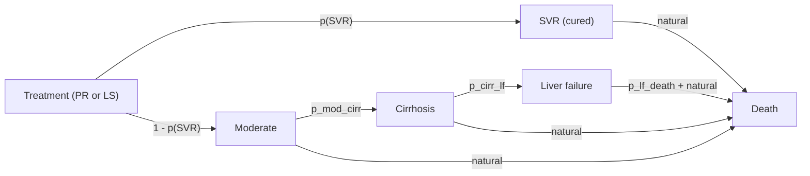
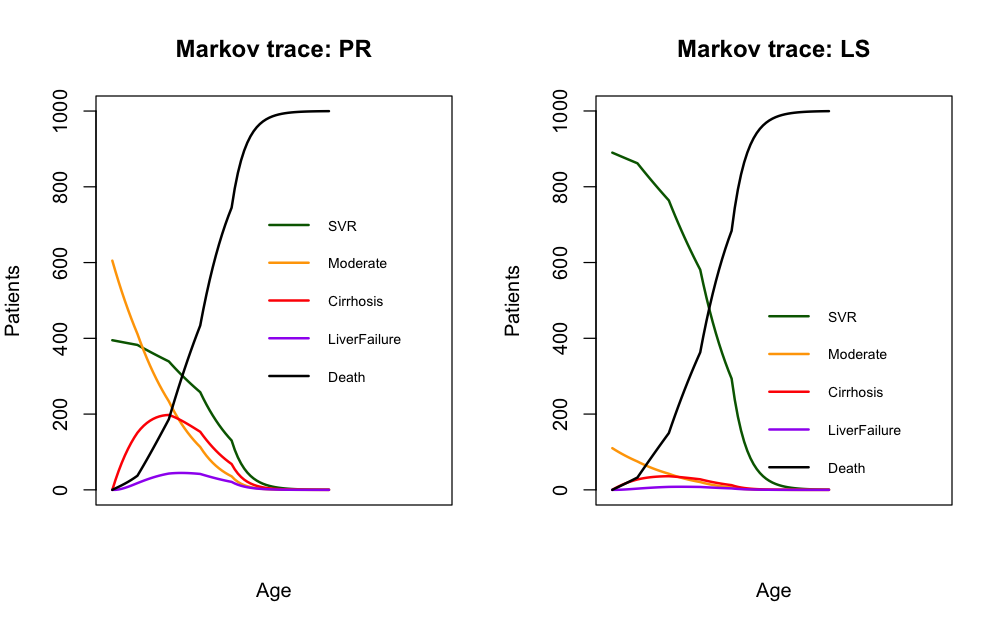
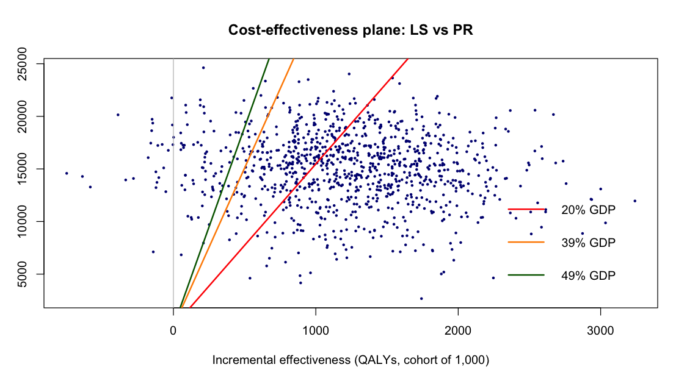
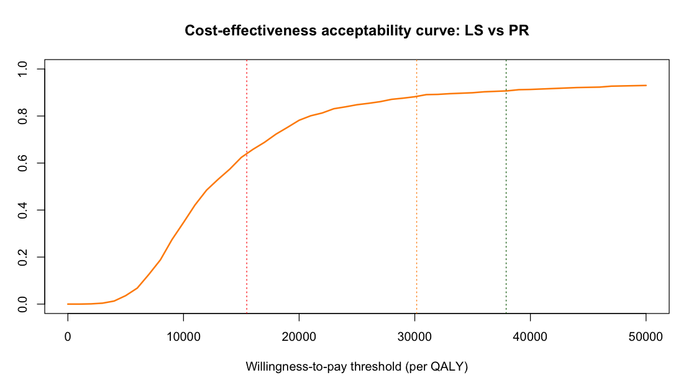

# Cost-effectiveness of ledipasvir/sofosbuvir (LS) vs pegylated interferon/ribavirin (PR) for chronic hepatitis C: a Markov model in R

A Markov cohort cost-effectiveness analysis in base R (no packages needed).
It re-implements a model originally built in Excel as coursework, including
deterministic and probabilistic sensitivity analyses.
This is an educational exercise, not a published analysis.

## Model overview

- **Cohort:** 1,000 patients with chronic hepatitis C, starting at age 40
- **Strategies:** PR vs LS (the new regimen)
- **States:** SVR (cured), Moderate disease, Cirrhosis, Liver failure, Death
- **Structure:** treatment success (SVR) sets the initial split of the cohort. Non-responders
  progress **irreversibly** Moderate → Cirrhosis → Liver failure. Death is absorbing, from liver failure
  or natural causes (age-specific) in any state. SVR patients are cured **for good**, with no re-infection.
- **Time:** 1-year cycles, 70 cycles (ages 41 to 110), lifetime horizon
- **Discounting:** 3.5% per year for **both** costs and outcomes
- **Outcomes:** costs, QALYs, ICER, net monetary benefit (NMB)
- **Willingness-to-pay (WTP):** 20%, 39% (base) and 49% of GDP per capita
  (GDP per capita 2023: 77,350.76 EGP, so 15,470 / 30,167 / 37,902 EGP per QALY)
- **Currency:** EGP
- **Conventions inherited from the Excel model:** cycle 1 is the initial allocation (decision tree);
  treatment cost is paid once at cycle 0 and not discounted.

"Natural" = age-specific background mortality. In each cycle, patients who do not move stay in their current state.

## Uncertainty analyses

| Input | One-way (tornado) | Threshold analysis | PSA |
|---|---|---|---|
| SVR rates, transition probabilities, utilities, state costs (12 inputs with a standard error) | mean ± 1.96 × SE | not used | drawn from distributions |
| Discount rate | scenario, 2% to 6% (cost and QALY rates varied together) | not used | fixed |
| LS price | not varied | maximum price solved for | fixed |
| PR price, natural mortality | fixed | fixed | fixed |

**PSA distributions:** beta for probabilities and utilities, gamma for costs, with parameters
derived from each mean and SE by the method of moments. 1,000 Monte Carlo iterations (**`set.seed(123)`**).

**Threshold analysis:** NMB is linear in the LS price, so the maximum price at which NMB ≥ 0
is NMB(price = 0) / cohort size.

## Results

### Base case (per patient, discounted)

| | Cost (EGP) | QALYs |
|---|---|---|
| PR | 33,868 | 11.299 |
| LS | 48,994 | 12.520 |
| Incremental | 15,126 | 1.221 |

**ICER: 12,387 EGP per QALY gained.** Cohort NMB at the 39% GDP threshold: 21,711,933 EGP.

### Deterministic sensitivity analysis

The tornado diagram ranks the inputs by how much the NMB changes across their ranges.
The largest drivers are the SVR utility, the discount rate and the Moderate-state utility.
At the base WTP, LS remains cost-effective across all ranges except when the SVR utility is at its
lower bound (0.608, below the Moderate utility of 0.66), where the NMB turns negative.

### Threshold analysis: maximum price of LS per patient

| WTP threshold | WTP per QALY (EGP) | Maximum LS price (EGP) |
|---|---|---|
| 20% of GDP per capita | 15,470 | 47,765 |
| 39% of GDP per capita | 30,167 | 65,712 |
| 49% of GDP per capita | 37,902 | 75,158 |

The current LS price of 44,000 EGP per patient is below the maximum price at all three thresholds.

### Probabilistic sensitivity analysis (1,000 simulations, cohort of 1,000)

| | Result |
|---|---|
| Mean incremental QALYs | 1,217.5 |
| Mean incremental cost (EGP) | 15,006,621 |
| ICER of the means (EGP per QALY) | 12,326 |

| WTP threshold | Probability LS is cost-effective |
|---|---|
| 20% of GDP (15,470) | 63.9% |
| 39% of GDP (30,167) | 88.5% |
| 49% of GDP (37,902) | 90.7% |

The PSA mean ICER is close to the deterministic base case (12,326 vs 12,387).

## Limitations

- Utilities are drawn independently, so the SVR utility can fall below the Moderate utility
  (in roughly a quarter of PSA draws), which is clinically implausible. This produces some draws with
  negative incremental QALYs and keeps the CEAC below 100% at high WTP. The same applies to the lower
  bound in the one-way analysis.
- Discount rates for costs and outcomes are varied jointly, not separately.
- Natural mortality and treatment prices are fixed in the PSA.

## How to run

1. Install [R](https://cran.r-project.org) (RStudio is optional).
2. Open `markov_cea_PR_vs_LS.R` and run it from top to bottom. No packages are needed.
   The probabilistic analysis runs 1,000 model iterations and may take some seconds.

## Author

Min Kang
